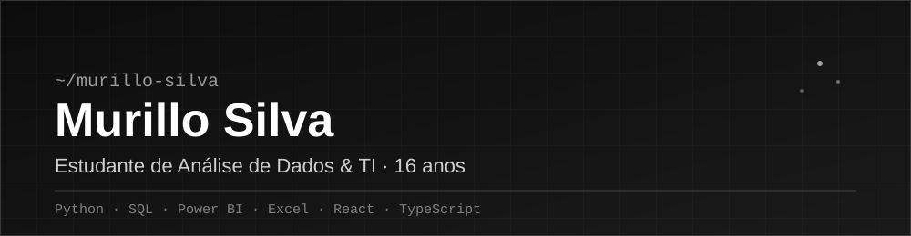

 

 

## 🧑‍💻 Sobre mim

- 🎓 Tenho **16 anos** e estou cursando **Análise de Dados / TI**
- 📊 Gosto de transformar números e planilhas em informação que faz sentido
- 💻 Também construo sites e aplicações web — já tenho projetos publicados
- 🚀 Sempre aprendendo algo novo: Python, SQL, Power BI, React...
- 📫 Me chama: **murillosilva4ds@gmail.com**

 

## 🛠️ Tecnologias

  
  
  
  
   
  
  
  
  
  

 

## 📂 Projetos em destaque

<table>
<tr>
<td width="50%">

### 🧾 PropostaPro
Ferramenta para criar propostas comerciais de forma rápida e profissional. Site ativo e publicado.

**[🔗 Ver projeto](https://propostapro-pi.vercel.app/)**

</td>
<td width="50%">

### 🏢 Zentus Consultoria
Site institucional completo, do zero ao ar, para uma consultoria.

**[🔗 Ver projeto](https://www.zentusconsultoria.com/)**

</td>
</tr>
</table>

### 🌐 Meu portfólio completo
**[murillo-silva-digital-story.vercel.app →](https://murillo-silva-digital-story.vercel.app/)**

 

## 📊 Estatísticas do GitHub

 

 

## 📬 Contato

 

© 2026 Murillo Silva · feito com código

